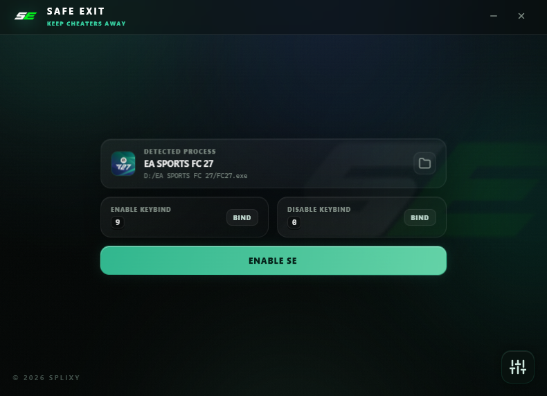
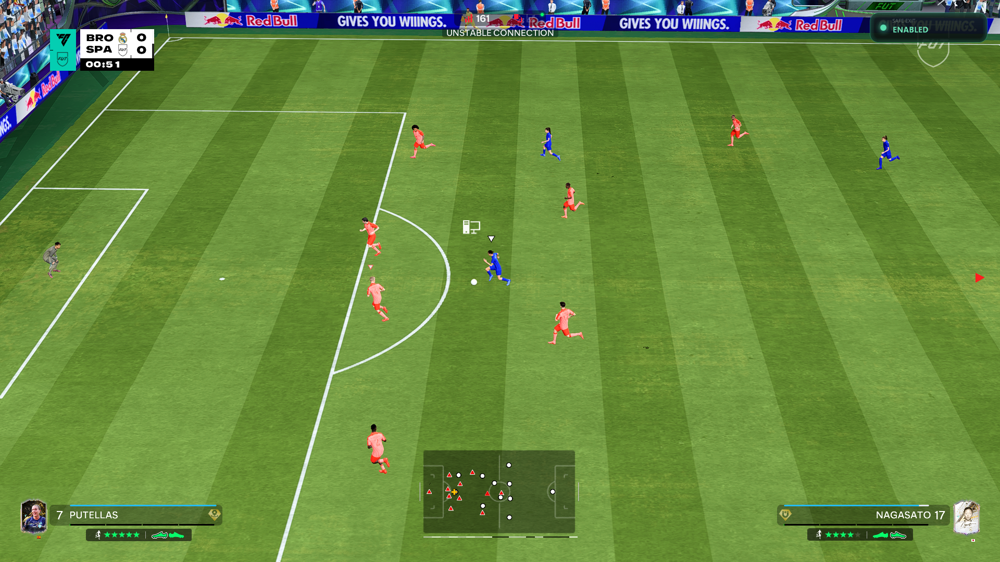

# Safe Exit

Safe Exit is a small app for Windows made for the **EA FC** series (FC 27 and newer).

If you match up against a cheater online, Safe Exit lets you get out of the game without it counting as a loss, so your record and your progress stay clean.

> **Only use Safe Exit when you are actually facing a cheater.**
> If you are not sure your opponent is cheating, use it at your own risk — it may still count as a loss.

## Screenshots

## How to use it

1. Download and open **Safe Exit**.
2. Windows will ask for permission the first time — click **Yes**.
3. Start the game the way you normally do and join a match.
4. Safe Exit finds your game on its own and shows it on screen.
5. When you meet a cheater, switch Safe Exit on.
6. To get out of the match safely, press your key (or use the button). From there you are free to leave.
7. Open **Settings** (the button in the bottom corner) any time to change your keys, move the small on-screen badge, keep the window on top, or fade the window.

## Please read first

- **Use it only against cheaters.** It is here to protect fair players, not to help anyone cheat.
- **If you are not sure your opponent is a cheater, use it at your own risk.** Leaving a normal match may still count as a loss.
- Safe Exit runs on your own PC. It never asks for your account, your passwords, or any personal information.

## Open source

This project is open source. You are welcome to read the code, learn from it, and build on it.

The look of the app (the interface) is kept private and is **not** part of this repository. Everything else is included.

## Disclaimer

- **Do not use it against other players if you suspect cheating.** The tool was created to help fair players, but not to help someone else cheat.
- **Do not use it if you are unsure about your opponent being a cheater.** Abandoning an ordinary game session will be considered a defeat.
- The program works locally on your PC without requesting your account or any other private data.

## Credits

Created by **Splixy**.

## Disclaimer

- **Do not use it against other players if you suspect cheating.** The tool was created to help fair players, but not to help someone else cheat.
- **Do not use it if you are unsure about your opponent being a cheater.** Abandoning an ordinary game session will be considered a defeat.
- The program works locally on your PC without requesting your account or any other private data.

## Open source

It is an open source project. Feel free to read, learn and develop from the code.

The look of the app (the interface) is kept private and is **not** part of this repository. Everything else is included.

## Credits

Made by **Splixy AKA Fares**.
