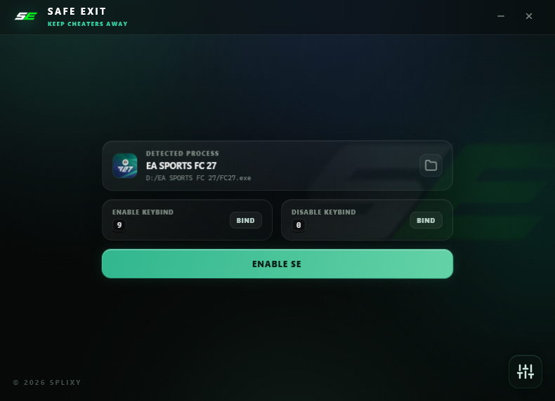
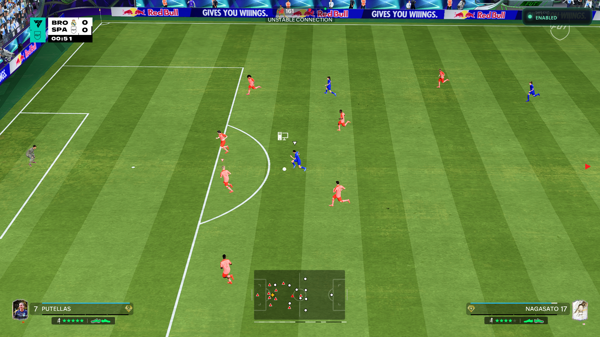

# Safe Exit

Safe Exit is a small app for Windows made for the **EA FC** series (FC 27 and newer).

If you match up against a cheater online, Safe Exit lets you get out of the game without it counting as a loss, so your record and your progress stay clean.

## Screenshots

## How to use it

1. Download and open **Safe Exit**.
2. Windows will ask for permission the first time, click **Yes**.
3. Start the game the way you normally do and join a match.
4. When you meet a cheater, switch Safe Exit on.
5. To get out of the match safely, press your key (or use the button). From there you are free to leave (you must not concede a goal).

## Disclaimer

- **Do not use it against other players if you suspect cheating.** The tool was created to help fair players, but not to help someone else cheat.
- **Do not use it if you are unsure about your opponent being a cheater.** Abandoning an ordinary game session will be considered a defeat.
- **Safe Exit runs on your own PC.** It never asks for your account, your passwords, or any personal information.

## Source Available

The code for this project is publicly available. You are welcome to read the code, learn from it, and build on it for **personal, non-commercial use only**. 

If you use or modify this code, you **must** give credit to the original author. You are strictly prohibited from selling or monetizing this software in any way.

The look of the app (the interface) is kept private and is **not** part of this repository. Everything else is included.
